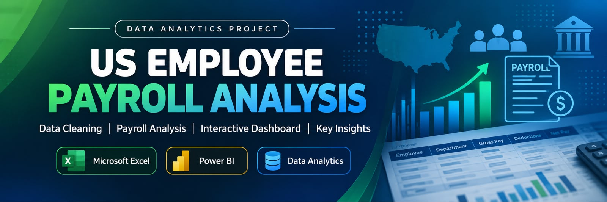

📌 Project Overview

This project analyzes US employee payroll data to understand payroll costs, department-wise spending, job-title-wise payroll, and payroll trends.

🎯 Project Objectives

* Clean and prepare payroll data using Excel.
* Identify and handle duplicate and missing values.
* Calculate total and average payroll.
* Analyze payroll by department, job title, and payroll period.
* Build an interactive Power BI dashboard.

🧹 Data Cleaning

* Removed duplicate records and checked missing values.
* Standardized data formats.
* Filtered and sorted payroll records.
* Prepared data for analysis.

📊 Dashboard Highlights

* Total Payroll
* Average Payroll
* Number of Records
* Payroll Amount by Department
* Payroll Amount by Job Title
* Payroll Period Slicer

🔍 Key Findings

The dashboard provides an overview of payroll distribution across departments and job titles. The payroll period slicer allows users to explore selected periods.

⚠️ Project Limitations

The dataset does not contain detailed federal and state payroll tax information.

✅ Conclusion

Excel and Power BI were used to clean, analyze, and visualize employee payroll data. The dashboard helps users explore payroll costs interactively.
