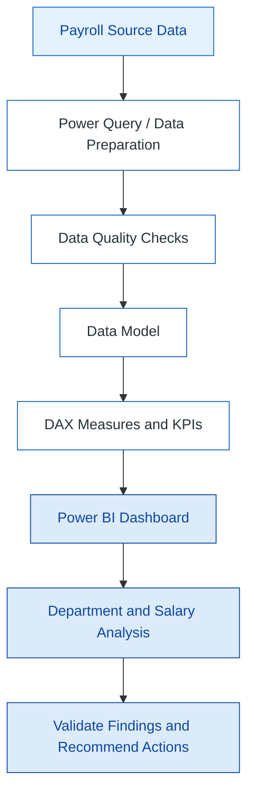
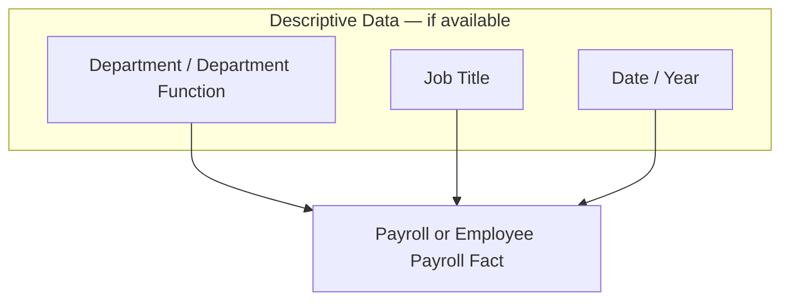

# 💼 US Employee Payroll Analysis | Excel · Power Query · Power BI · DAX

<div align="center">


<br/>


*Transforming employee payroll data into clear financial insights and department-level workforce reporting.*

</div>

---

## 📌 1. Executive Summary

**US Employee Payroll Analysis** is a Power BI business intelligence project designed to explore employee salary data, payroll expenditure, department-level costs, job titles, and workforce distribution.

The dashboard brings payroll indicators together in an interactive report so users can compare departments, review salary appropriations, inspect job-title-level amounts, and filter results by department and department function.

The project focuses on five business questions:

| Business Question | Analytical Objective |
|---|---|
| How much is being spent on payroll? | Monitor overall payroll and salary totals. |
| Which departments account for the largest payroll costs? | Compare department-level expenditure. |
| How is payroll distributed across department functions? | Understand the contribution of each function to total payroll. |
| How does payroll vary by job title and appropriation? | Explore salary amounts across roles and payroll categories. |
| How is the workforce distributed across departments? | Compare employee counts across departments. |

### 🎯 Business Objectives

- Analyze total payroll and salary-related amounts.
- Compare payroll costs across departments.
- Examine salary distribution by department function.
- Analyze payroll by job title and appropriation category.
- Compare employee counts across departments.
- Provide interactive filtering for department and function.
- Support payroll reporting, budget review, and further investigation.

> This is a descriptive analytics dashboard. It highlights patterns in the displayed data; it does not by itself establish why salary differences exist or whether a payroll amount is correct.

## 🛠️ 2. Technology Stack

| Technology | Purpose |
|---|---|
| Microsoft Excel | Source data review and validation, where applicable |
| Power Query | Data cleaning, shaping, and transformation, where implemented |
| Power BI Desktop | Interactive reports and visual analytics |
| DAX | Measures, aggregations, and KPI calculations, where implemented |
| Data Modeling | Organizing payroll records and descriptive fields for analysis |
| GitHub | Project documentation and portfolio presentation |

*The exact transformation steps, data model, and DAX measures should be documented after checking the underlying source workbook and report model.*

---

## 📊 3. Dashboard Overview

The attached report screenshots show two dashboard pages with payroll summaries, department comparisons, and interactive filters.

### Page 1 — US Employee Payroll Overview

**Business question: What does payroll look like across departments and functions?**

Visible report elements include:

- Total payroll cost by department
- Payroll cost by year
- Payroll cost distribution by department function
- Department-wise payroll summary table
- Monthly Salary KPI card
- Total Salary KPI card
- Average Salary KPI card
- Total Employees KPI card
- Department Function filter

**Management objective:** Provide a high-level view of payroll expenditure and identify departments or functions that may warrant closer review.

### Page 2 — Job Title, Appropriation & Department Analysis

**Business question: How are payroll amounts and employee counts distributed across roles and departments?**

Visible report elements include:

- Job-title table with salary amount totals
- Sum of Amount by Appropriation chart
- Employee Count by Department chart
- Department Function filter
- Department filter

**Management objective:** Help users inspect payroll amounts by role and appropriation category, compare department headcounts, and investigate individual categories using filters.

### 📷 Dashboard Screenshots

Add the screenshots to your repository using the suggested filenames below, then uncomment or update the image links:

```text
Screenshots/
├── payroll_overview.png
└── job_title_and_department_analysis.png
```

```markdown


```

---

## 📈 4. Key Performance Indicators

The following values are visible in the supplied screenshots. Treat them as **displayed dashboard values**, not independently audited payroll figures.

| KPI | Displayed Value | Interpretation |
|---|---:|---|
| Monthly Salary | $10.45M | Dashboard's monthly salary indicator; confirm the underlying measure and time basis. |
| Total Salary | $103.68M | Dashboard's total salary indicator; confirm the aggregation and reporting period. |
| Average Salary | $16.00K | Dashboard's average salary indicator; confirm whether it is per employee, per period, or another calculation. |
| Total Employees | 2K | Rounded employee-count card; confirm the exact count and whether it counts distinct employees. |

The department summary visual also displays amounts by department, including Chicago Police Department, Chicago Fire Department, Department of Family and Support Services, Department of Housing, Department of Planning and Development, Department of Public Health, and Office of the Mayor.

> **Validation note:** The visible KPI cards and table totals may use different filters, aggregations, periods, or number formats. Reconcile them with the source data and model before publishing exact figures as verified results. Confirm the currency, reporting period, definition of “salary,” and whether employee counts use distinct employee IDs.

---

## 🔎 5. Analytical Areas

### Department-Level Payroll

Compare total payroll amounts across departments to identify the largest reported cost centers and departments that may need additional budget review.

### Payroll by Year

Review payroll totals across the years shown in the report. Confirm that the year field and measure represent comparable reporting periods before drawing trend conclusions.

### Payroll by Department Function

Examine the payroll contribution of the department functions shown in the dashboard, including Public Safety, Community Services, City Development, and Finance and Administration.

### Job Title and Salary Amounts

Use the job-title table to inspect salary amounts associated with individual roles. Investigate negative values, unusually high amounts, or unexpected role-level totals against the source records and business rules.

### Appropriation Analysis

Compare amounts across appropriation categories, including overtime, salaries and wages, and other categories shown in the report. Validate the category definitions and units before using this analysis for budget decisions.

### Employee Count by Department

Compare the displayed employee counts by department. Confirm whether the visual counts rows or distinct employees, and ensure that department assignments are consistent.

---

## ⚙️ 6. Suggested End-to-End Workflow

<div align="center">


</div>



### Data Preparation Checklist

- [ ] Inspect source sheets, columns, and data types.
- [ ] Standardize department names and job-title values.
- [ ] Validate salary and amount fields as numeric values.
- [ ] Check missing employee identifiers and department assignments.
- [ ] Investigate duplicate records using the defined row grain.
- [ ] Confirm date and year fields and the reporting period.
- [ ] Reconcile source totals with Power BI totals.
- [ ] Validate all KPI definitions and filters after refresh.

---

## 🏗️ 7. Data Modeling — Recommended Approach

A suitable model depends on the actual source tables and the grain of the payroll data. Do not treat the conceptual diagram below as a verified representation of the uploaded PBIX model.



### Modeling Principles

- Define what one row represents before writing measures.
- Use unique dimension keys where dimensions are modeled separately.
- Avoid duplicate employee records inflating headcount calculations.
- Use a date table when time-based analysis requires it.
- Prefer clear one-to-many relationships when supported by the data.
- Avoid unsupported relationships between unrelated fact tables.
- Reconcile payroll totals and employee counts after changing the model.

### Model Validation Checklist

- [ ] Identify the source table or tables used by each visual.
- [ ] Document the grain of each table.
- [ ] Identify employee, department, job-title, and date keys where present.
- [ ] Check uniqueness on dimension-side keys.
- [ ] Check unmatched keys and missing department values.
- [ ] Review relationship cardinality and filter direction.
- [ ] Confirm totals under different slicer selections.

---

## 🧮 8. DAX Measures — Illustrative Templates

The measures below are **examples only**. Replace table and column names with the actual names in your model, and verify the business definitions before using them. They are not claimed to be the measures currently implemented in the PBIX.

### Total Salary Amount

```dax
Total Salary Amount =
SUM ( 'Payroll'[Amount] )
```

Use the correct salary or amount column and ensure that the source records are at the expected grain.

### Employee Count

If the source contains a unique employee identifier, a distinct count may be more appropriate than counting rows:

```dax
Employee Count =
DISTINCTCOUNT ( 'Payroll'[EmployeeID] )
```

Replace `EmployeeID` with the actual identifier. If the data does not contain an employee key, define and document an alternative counting rule.

### Average Salary per Employee

```dax
Average Salary per Employee =
DIVIDE ( [Total Salary Amount], [Employee Count] )
```

Use this only if total salary and employee count cover compatible populations and periods. It is not necessarily equivalent to an average salary per pay period.

### Payroll by Department

Use the total salary measure in a visual with the validated department field on the axis or rows. The department filter context should determine the department-level result.

### DAX Best Practices

- Prefer reusable measures for filter-responsive KPIs.
- Use `DIVIDE()` for ratios and guard against zero denominators.
- Use distinct employee counts when the data grain requires them.
- Apply consistent currency, decimal, and display-unit formats.
- Test measures with department and function slicers.
- Reconcile report totals against source data.

---

## 🧹 9. Data Quality and Validation

Payroll reporting requires consistent definitions and careful handling of employee and financial records.

### Recommended Checks

1. Validate the source and reporting period.
2. Confirm currency and amount units.
3. Check null, blank, and invalid salary values.
4. Investigate negative amounts according to documented payroll rules.
5. Check duplicates without removing legitimate multiple payroll entries.
6. Confirm employee identifiers and department mappings.
7. Verify that department names and job titles are standardized.
8. Reconcile totals by department and appropriation.
9. Test the impact of filters on KPI cards and tables.
10. Refresh the report and rerun key checks.

### Important Interpretation Notes

- High payroll expenditure does not automatically mean a department is overspending; staffing levels, role mix, overtime, and the reporting period may explain differences.
- A high or low job-title total should be investigated using source records and context.
- The employee card is displayed in rounded thousands in the screenshot, so it should not be quoted as an exact headcount.
- Salary, appropriation, overtime, and employee-count definitions should be documented before making policy or budget recommendations.

---

## 🎨 10. Dashboard Design

The report uses a blue-and-white visual theme with light dashboard panels, blue charts, KPI cards, tables, and slicers.

| Element | Suggested Color |
|---|---|
| Primary blue | `#1565C0` |
| Dark blue | `#0D47A1` |
| Light blue | `#E3F2FD` |
| Dashboard background | `#155E9A` |
| Main text | `#263238` |
| White panels | `#FFFFFF` |

### Design Principles

- Keep KPI labels and reporting periods explicit.
- Use consistent currency and number formats.
- Keep department names readable in charts and tables.
- Use slicers consistently across related visuals.
- Label charts with the business question they answer.
- Avoid clutter and validate that filters behave as intended.
- Apply conditional formatting only with documented thresholds.

---

## 🚀 11. How to Open the Project

1. Open `US Employee Payroll Analysis Mini Project.pbix` in Power BI Desktop.
2. Review the data model and identify the source tables and fields.
3. Check Power Query steps and source paths.
4. Inspect the DAX measures used by the KPI cards and visuals.
5. Refresh the report if the source data is available and accessible.
6. Reconcile the KPI cards and department totals against the source.
7. Save dashboard screenshots for the repository.

> The PBIX file was supplied with this project, but the README does not assume that a separate source workbook, public GitHub repository, or external data source is available. Add links only after those resources have been uploaded and verified.

---

## 📂 12. Suggested Repository Structure

```text
US-Employee-Payroll-Analysis/
│
├── README.md
├── US Employee Payroll Analysis Mini Project.pbix
├── Screenshots/
│   ├── payroll_overview.png
│   └── job_title_and_department_analysis.png
│
└── Documentation/
    ├── data_dictionary.md
    ├── dax_measures.md
    └── data_quality_checks.md
```

This is a suggested structure. Add documentation folders and files when the corresponding content is ready. Avoid uploading confidential employee-level or personally identifiable payroll information to a public repository.

---

## 💼 13. Skills Demonstrated

- Power BI report development
- Payroll and salary analytics
- Department-level cost analysis
- Data visualization and dashboard layout
- KPI reporting
- Job-title and appropriation analysis
- Employee-count analysis
- Interactive filtering and slicers
- Data quality validation
- DAX measure design (where implemented)
- Power Query transformation (where implemented)
- Business insight communication
- GitHub project documentation

---

## 🔮 14. Future Enhancements

- Add a validated data dictionary and measure definitions.
- Include budget-versus-actual analysis if budget data is available.
- Add monthly or yearly payroll trends with clearly defined periods.
- Compare overtime amounts and proportions by department.
- Add employee headcount trends if reliable employee/date data exists.
- Create drill-through pages for department and job-title analysis.
- Add data-quality indicators and refresh validation.
- Define documented thresholds for payroll exceptions.
- Add role-based access and privacy controls where required.
- Include variance analysis only when comparable historical or budget data is available.

---

## 👨‍💻 15. About the Project

The **US Employee Payroll Analysis** project demonstrates how an interactive Power BI report can help users explore payroll expenditure, department-level cost distribution, salary amounts by job title and appropriation, and employee counts.

*Focus areas:* Payroll Analytics · Workforce Reporting · Power BI · Data Visualization · DAX · Business Intelligence

<div align="center">

*Turning payroll data into clear, reviewable business insights.*


</div>

---

## Author

Add your preferred display name and professional links here before publishing.

- **Name:** Your Name
- **LinkedIn:** Add your LinkedIn profile URL
- **GitHub:** Add your GitHub profile URL

---

*Note: KPI values and visual descriptions in this README are based on the supplied dashboard screenshots. Confirm all definitions, calculations, units, and source totals in Power BI before presenting them as audited results.*

